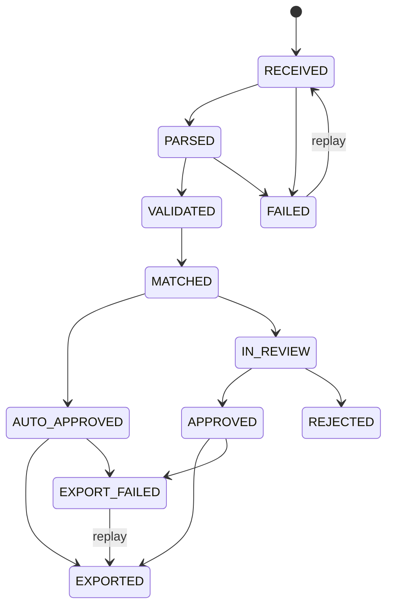

# Architecture

Status: **design**. The diagram shows the target architecture. What is actually built is tracked in [CHANGELOG.md](CHANGELOG.md) and the README "Status" table.

## Pipeline

```mermaid
flowchart LR
  subgraph Ingest
    U["Upload API / S3 drop<br/>inbox/{tenant}/"] --> EB["EventBridge<br/>Object Created"]
    EB --> Q1["SQS ingest + DLQ"]
    Q1 --> L0["Lambda: start-execution<br/>execution name = idempotency key"]
  end
  L0 --> C
  subgraph SFN["Step Functions (Standard): invoice pipeline"]
    C["Classify format"] -->|XRechnung| PX["Parse UBL / CII"]
    C -->|ZUGFeRD| FX["factur-x: extract XML"] --> PX
    C -->|PDF| BR["Bedrock Claude extraction<br/>tool-use JSON schema"] --> CII["Serialize to CII"]
    PX --> N["Normalize to canonical model"]
    CII --> N
    N --> V["Validate: KoSIT + XRechnung config"]
    V --> D["Duplicate check"]
    D --> M["2-way PO match"]
    M --> R{"Decision"}
    R -->|clean| EXQ
    R -->|exception| HR["Review task<br/>waitForTaskToken"]
    HR -->|approve / correct| EXQ["SQS export + DLQ"]
    HR -->|reject| END["Rejected"]
  end
  EXQ --> LX["Lambda: export"] --> ERP["Mock ERP API<br/>idempotent"]
  UI["React review UI"] --> API["Review API (FastAPI on Lambda)<br/>API GW HTTP + Cognito JWT"]
  API --> DDB[("DynamoDB")]
  API -->|SendTaskSuccess| HR
  SFN --> DDB
  BR -.trace.-> LF["Langfuse Cloud (EU)"]
  SFN -.logs / metrics.-> CW["CloudWatch + X-Ray"]
  V --- KV["KoSIT validator<br/>Lambda container (Java)"]
```

## Runtime modes
| Mode | What runs | Needs AWS account? |
|---|---|---|
| `RF_MODE=local` | The same pipeline steps run in-process. Storage is SQLite and the filesystem. The extractor is `fake` or `recorded`. KoSIT runs as a docker-compose daemon. | No |
| `RF_MODE=aws` | Terraform in `infra/terraform/envs/aws-dev`, applied by the owner of a sandbox account | Yes |

AWS adapters are integration-tested in-process with [`moto`](https://github.com/getmoto/moto). We do not use LocalStack: its open-source repository was archived on 2026-03-23, and it now needs an auth token (see ADR-0009).

Both modes share one code path. Every side effect goes through a port in `src/rechnungsfluss/ports/`, and `adapters/local` and `adapters/aws` implement those ports.

## Canonical data model
The model is based on the EN 16931 semantic model. Field names carry their BT/BG identifier in the docstring.

| Group | Fields |
|---|---|
| Header | BT-1 invoice number, BT-2 issue date, BT-3 type code, BT-5 currency, BT-9 due date, BT-10 buyer reference, BT-13 purchase order reference |
| Seller (BG-4) | BT-27 name, BT-31 VAT identifier, BT-84 payment account (IBAN) |
| Buyer (BG-7) | BT-44 name |
| Totals (BG-22) | BT-106 line net sum, BT-109 total without VAT, BT-110 VAT total, BT-112 total with VAT, BT-115 amount due |
| Lines (BG-25) | BT-126 line id, BT-129 quantity, BT-130 unit, BT-131 line net amount, BT-132 referenced PO line, BT-146 net price, BT-151 VAT category, BT-152 VAT rate |
| VAT breakdown (BG-23) | BT-116 taxable amount, BT-117 tax amount, BT-118 category, BT-119 rate |

Each extracted field carries provenance: `source ∈ {xml, llm, human}` and an optional `confidence`.

## Storage (DynamoDB)
`rf-main` uses a single-table design. `rf-audit` (append-only) and `rf-idempotency` are separate tables.

| Entity | PK | SK |
|---|---|---|
| Document | `TENANT#t#DOC#sha256` | `META` |
| Invoice | `TENANT#t#INV#id` | `V#n` (immutable versions), `CURRENT` |
| PurchaseOrder | `TENANT#t#PO#no` | `META`, `LINE#n` |
| ReviewTask | `TENANT#t#INV#id` | `REVIEW` (GSI1 `TENANT#t#STATUS#open`) |
| DupIndex | `TENANT#t#DUP#vat#no` | `INV#id` |
| Export | `TENANT#t#INV#id` | `EXPORT` |
| AuditEvent (`rf-audit`) | `TENANT#t#INV#id` | `ts#seq` |

Every key starts with `TENANT#<id>`. In AWS, IAM `dynamodb:LeadingKeys` conditions bound to the `tenant` session tag enforce this, so isolation does not depend only on application code (ADR-0006).

## Invoice states

